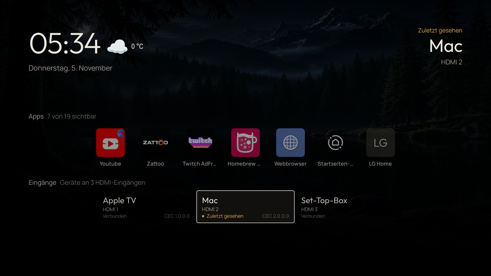

# Install Glasshouse Mod on an LG TV

This fork adds weather beside the clock, centered Apps and Inputs rows, and four Waldsee wallpapers. These steps install the published package and upgrade an existing Glasshouse installation in place. Version 0.139.1 was installed this way on an LG G5 running webOS 10.3.1; its settings and uploaded wallpapers remained unchanged.



## Requirements

- A rooted LG TV with the [Homebrew Channel](https://github.com/webosbrew/webos-homebrew-channel) installed and SSH enabled.
- A computer on the same network with SSH and SCP, such as a Mac with Terminal.
- The TV's IP address and SSH credentials.

Glasshouse supports several webOS versions. The [compatibility table](tested-tvs.md) covers the upstream project; this fork was tested on the G5 described above.

## Install through the Homebrew Channel

1. Open the Homebrew Channel on the TV and go to **Settings → Repositories**.
2. Choose **Add repository** and enter this catalog URL:

   ```text
   https://raw.githubusercontent.com/Schrotty74/glasshouse-mod/launcher-weather-waldsee/repo.json
   ```

3. Return to the app list and refresh or reopen the Homebrew Channel. Find **Glasshouse Mod** and choose **Install**.
4. Open **Glasshouse** on the TV to install the included service. For a new installation, complete its setup dialog and enable network access if the dashboard should be available from a computer.

The fork uses the official app ID, so it replaces an existing Glasshouse app in place. Do not uninstall the existing app first: settings and uploaded wallpapers are retained. The installed TV tile is still named **Glasshouse**.

Keep this catalog enabled to receive future stable fork releases through the Homebrew Channel's update list. The default catalog also lists official Glasshouse under the same app ID; select **Glasshouse Mod** from the added fork catalog when choosing a package. Open Glasshouse after a package update to apply its service immediately; the running service also notices an updated package automatically.

The catalog is generated from each release's package and checksum manifest. Its URL stays the same, while each listed package points to a specific release. The SSH method below is an alternative.

## 1. Download the package

Open [this fork's releases](https://github.com/Schrotty74/glasshouse-mod/releases/latest). Under **Assets**, download the file ending in `.ipk`. For version 0.139.1, its name is:

```text
io.github.rorygallagher2024.lg-webos-dashboard_0.139.1_all.ipk
```

The accompanying `.manifest.json` contains the checksum under `ipkHash.sha256`. On a Mac, check the downloaded file with:

```sh
shasum -a 256 ~/Downloads/io.github.rorygallagher2024.lg-webos-dashboard_0.139.1_all.ipk
```

The result must match the checksum in the manifest. **Source code** is a source archive, not an installable TV package. For later releases, update the versioned filenames in the commands below.

## 2. Copy the package to the TV

Replace `TV_IP` with the TV's address. Run these commands on the computer and enter the TV's SSH password when prompted:

```sh
scp -O ~/Downloads/io.github.rorygallagher2024.lg-webos-dashboard_0.139.1_all.ipk root@TV_IP:/media/internal/glasshouse-mod_0.139.1.ipk
ssh -t root@TV_IP
```

After connecting, the commands entered in this terminal run on the TV.

## 3. Install the package and update the service

**Do not uninstall an existing official Glasshouse installation first.** The fork uses the same app ID and upgrades it in place.

Start the package installation on the TV:

```sh
luna-send -i luna://com.webos.appInstallService/dev/install '{"id":"io.github.rorygallagher2024.lg-webos-dashboard","ipkUrl":"/media/internal/glasshouse-mod_0.139.1.ipk","subscribe":true}'
```

Wait until the output contains `"state":"installed"`. Then press **Ctrl+C** to stop the status subscription. If installation reports an error, stop here without updating the service.

Install the service included in the package. This restarts Glasshouse; the TV does not need a reboot:

```sh
sh /media/developer/apps/usr/palm/applications/io.github.rorygallagher2024.lg-webos-dashboard/payload/install.sh
```

The installer retains the existing configuration in `/var/lib/tvweb`, including the weather location, app order, hidden tiles and uploaded wallpapers.

## 4. Check the version and update source

```sh
node /var/lib/tvweb/tvweb.js --check-update
grep '^var UPDATE_REPO' /var/lib/tvweb/lib/updater.js
```

The first command reports the installed version and latest published version. The second must print:

```text
var UPDATE_REPO = 'Schrotty74/glasshouse-mod';
```

Remove the uploaded installation file and disconnect:

```sh
rm /media/internal/glasshouse-mod_0.139.1.ipk
exit
```

On the computer, open `http://TV_IP:8080/`. This remains the TV's address; the fork does not need a separate IP address. Existing installations retain their configured port and access controls. For a new installation, the **Glasshouse** app may need to be opened on the TV first to allow network access in its setup dialog.

## 5. Set up Home, weather and Waldsee wallpapers

- Under **Home**, choose **Use Glasshouse Home** and confirm.
- Under **Home → Weather**, search for a place and select the matching result. Successful weather responses are cached for one hour.
- Download and extract `waldsee-wallpapers.zip` from the release. Under **Home → Wallpaper → Your own**, assign the files to their time-of-day slots: `morning.png`, `afternoon.png`, `evening.png` and `night.png`.

Uploading selects the pictures. An existing wallpaper selection is retained during an upgrade.

## Future updates

The updater under **Server** checks stable releases from `Schrotty74/glasshouse-mod`. Choose **Check now**, then **Install** when an update is offered. Updates require a published release with a higher numeric version and its installation assets. A commit or prerelease alone does not produce an update offer.

The Glasshouse entry in the Homebrew Channel's default catalog still belongs to the official project. For this fork, use the added fork catalog, its own updater or an IPK from the fork's releases.

For troubleshooting, check the service status and local log on the TV:

```sh
/var/lib/tvweb/tvwebctl status
tail -n 60 /var/lib/tvweb/tvweb.log
```
