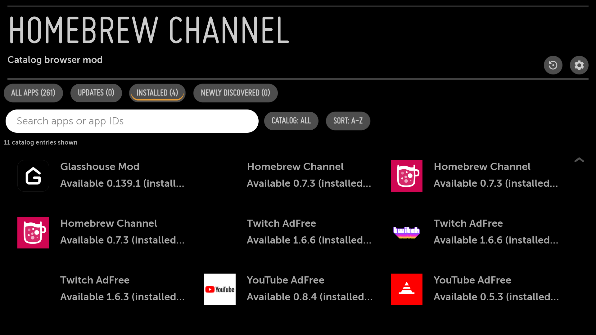

# Homebrew Channel catalogs

These are the additional catalog URLs used with this fork. In **Homebrew Channel → Settings → Repositories → Add repository**, add each desired URL separately, then refresh or reopen the app list.

| Catalog | Repository URL |
| :--- | :--- |
| Glasshouse Mod — this fork | <https://raw.githubusercontent.com/Schrotty74/glasshouse-mod/launcher-weather-waldsee/repo.json> |
| tbsniller/apps-repo | <https://tbsniller.github.io/apps-repo/api/apps.json> |
| webOS App Club | <https://webosappclub.github.io/> |
| GameFree24 | <https://gamefree24.ru/webos/repository.json> |
| Pastebin catalog | <https://pastebin.com/raw/YuSSrivd> |
| NicholasBly/youtube-webos | <https://raw.githubusercontent.com/NicholasBly/youtube-webos/main/repo.json> |
| Schrotty74/LG-G5-Apps | <https://raw.githubusercontent.com/Schrotty74/LG-G5-Apps/HEAD/repo.json> |

The default Homebrew Channel repository can stay enabled. It and the fork catalog may list the same app ID; **Glasshouse Mod** identifies this fork, and the app's details show its catalog URL.

This page stores links to public catalogs. Third-party catalog contents and app packages are not copied into this repository. Each app's own license and distribution terms apply; a catalog listing does not grant additional rights or make its apps part of Glasshouse Mod. Catalog availability and contents are controlled by their publishers.

For installing this fork, including upgrades from official Glasshouse, see the [installation guide](fork-installation.md).

## Optional Homebrew browser controls

The [catalog browser mod](https://github.com/Schrotty74/glasshouse-mod/blob/launcher-weather-waldsee/homebrew/catalog-browser/README.md) adds an update counter, Installed and Newly discovered views, search, a catalog filter and alphabetical sorting to Homebrew Channel 0.7.3. It includes a verified frontend package, an installer, a restore script and a source patch.

